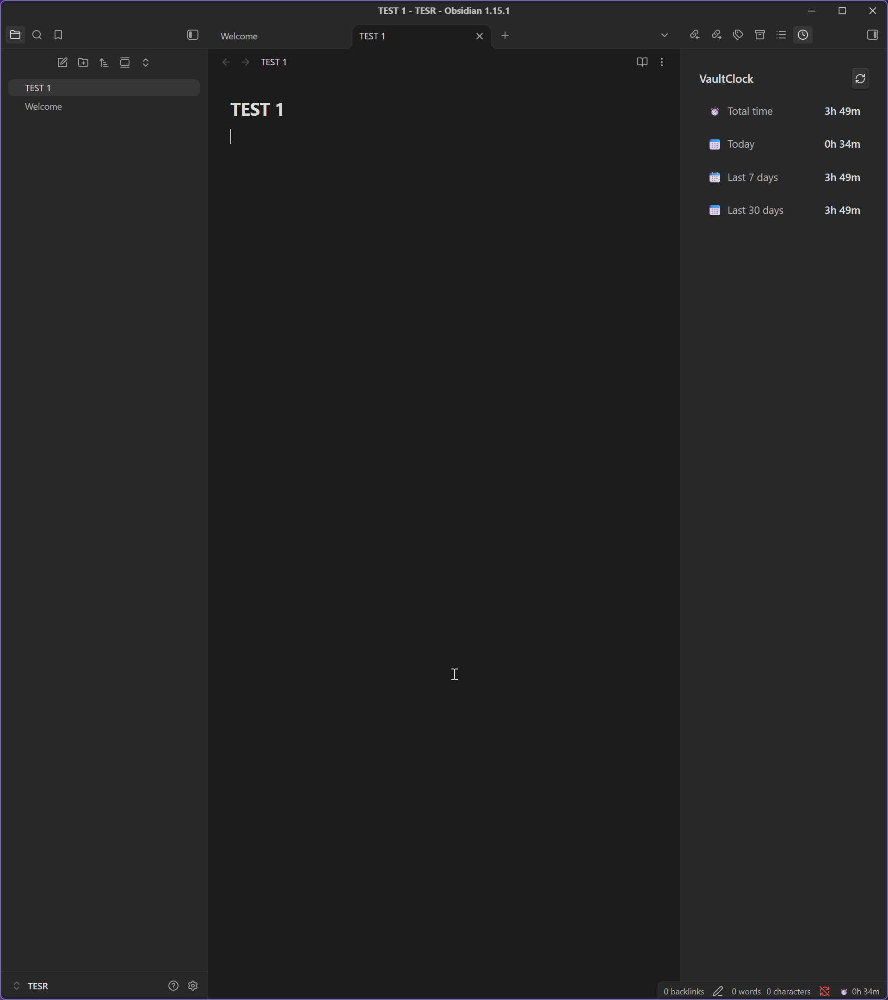

# 🕰️🔐 VaultClock — Obsidian Plugin

An Obsidian plugin that tracks how much time you spend in the app and shows four metrics: total time, today, last 7 days, and last 30 days. Quietly — no graphs, no clutter — just numbers in the status bar and a simple stats panel 👻

---

## 📑 Table of Contents

- [✨ Features](#features)
- [📸 Screenshot](#screenshot)
- [📦 Installation](#installation)
- [🛠️ How It Works](#how-it-works)
- [💡 Ideas & Feedback](#ideas)

---

<a id="features"></a>

## ✨ Features

- ⏱️ Tracks all time while Obsidian is running — no pauses, no idle detection, no focus tracking
- 📊 Four metrics: total time, today, last 7 days, last 30 days
- 📌 Status bar item: `⏱️ 2h 15m` — today's time, updated every 30 seconds
- 🖱️ Click the status bar item to open the stats panel
- 🧭 Commands in the palette: "Open statistics" and "Reset statistics"
- 💾 Local storage in `data.json`, nothing leaves your device
- 🌓 Works in both dark and light Obsidian themes
- 🗂️ Per-vault tracking — each vault has its own independent statistics
- 🪶 Minimal code and dependencies: TypeScript + esbuild, no external libraries
- 🌐 UI localization: Russian and English. The plugin language is automatically detected from the Obsidian app language

---

<a id="screenshot"></a>

## 📸 Screenshot




---

<a id="installation"></a>

## 📦 Installation

### Manual

1. Download the three files: `main.js`, `manifest.json`, `styles.css`
2. Create a folder named `vaultclock` in `<Your Vault>/.obsidian/plugins/`
3. Place all three files in that folder
4. Open **Settings → Community plugins** and enable **VaultClock**

### From Source

```bash
git clone https://github.com/RamenOfficialGovPatsy/VaultClock.git
cd VaultClock
npm install
npm run build
```

Then copy `main.js`, `manifest.json`, and `styles.css` to `<Your Vault>/.obsidian/plugins/vaultclock/` and enable the plugin in settings.

> **Note:** the plugin is not yet published in the Obsidian community plugins directory. 🕰️

---

<a id="how-it-works"></a>

## 🛠️ How It Works

- Format — `Xh Ym`. If the value is less than a minute, `< 1m` is shown.
- A tick every 30 seconds adds 30 seconds to the counter for the current date.
- When the window is minimized (`visibilitychange`), closed (`beforeunload`), or the plugin is unloaded (`onunload`), the remainder since the last tick is added and `data.json` is saved.
- `data.json` stores only daily totals: `{ "days": { "YYYY-MM-DD": seconds } }`.
- On plugin startup, counting begins from the current moment — time that passed while the plugin was not running is not added (protection against double-counting after a crash).
- The `data.json` file lives in `.obsidian/plugins/vaultclock/` of a specific vault, so statistics are independent per vault.

The plugin uses Obsidian CSS variables (`--background-secondary`, `--text-normal`, `--text-muted`), so it automatically adapts to the theme. There are no separate color settings — and none are needed.

---

<a id="ideas"></a>

## 💡 Ideas & Feedback

Have an idea for something missing? Want to suggest a new metric or display option?

You can open an issue in the GitHub repository or write on the Obsidian forum.

The plugin is intentionally minimalist, but if an idea fits the "simple and stable" philosophy — it will be considered. 🕰️